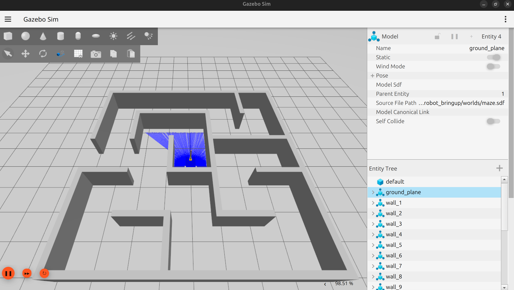
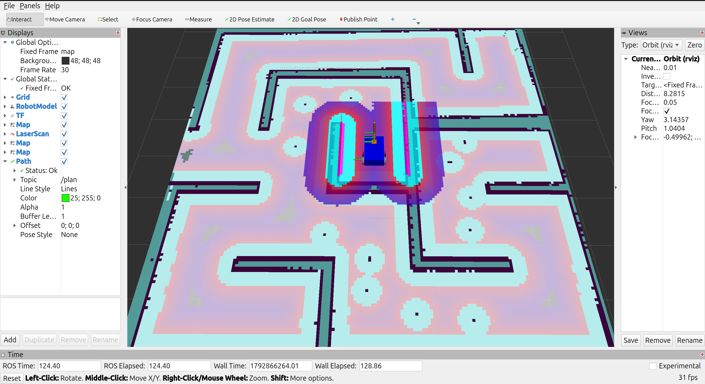
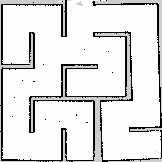

# Nav2 + SLAM Mobile Robot

Autonomous navigation for a custom differential-drive robot, built with **ROS 2 Jazzy**, **Nav2** and **SLAM Toolbox** in **Gazebo Harmonic**. The robot has a 2D lidar, a front camera and a small 2-joint arm. I mapped the world with SLAM and then navigated it with Nav2 on the saved map.

## Demo

**Simulation world (Gazebo)**



**Navigation in RViz: map, costmaps and planned path**



**Map built with SLAM Toolbox**



## What's in this project

- A modular robot description in xacro (chassis, wheels, caster, camera, lidar, arm)
- A ROS-Gazebo bridge configured through a yaml file
- Mapping with `slam_toolbox` (online async mode)
- Navigation with Nav2 and AMCL on the saved map, using the robot's real footprint
- Two launch files: one for simulation and RViz, one for Nav2

## The robot

| Part | Details |
|---|---|
| Base | 0.6 x 0.4 x 0.2 m box, differential drive, one caster wheel |
| Wheels | radius 0.1 m, separation 0.45 m |
| Lidar | 2D, 270 degree field of view, 8 m range, 10 Hz, mounted on top of the front of the chassis |
| Camera | 640x480, 20 Hz, front facing |
| Arm | 2 revolute joints driven by position controllers (kept upright while navigating) |

TF tree: `map -> odom -> base_footprint -> base_link -> laser_link / camera_link / arm_base_link`

## Repository layout

```
src/
├── my_robot_description/    # Robot model and RViz config
│   ├── urdf/                # xacro files: base, camera, lidar, arm, Gazebo plugins
│   ├── launch/display.launch.xml
│   └── rviz/urdf_config.rviz
└── my_robot_bringup/        # Simulation, mapping and navigation setup
    ├── launch/
    │   ├── my_robot_gazebo.launch.xml   # Gazebo + robot + bridge + RViz
    │   └── nav2.launch.xml              # Nav2 on the saved map
    ├── config/
    │   ├── gazebo_bridge.yaml           # ros_gz_bridge topics
    │   ├── mapper_params.yaml           # slam_toolbox parameters
    │   └── nav2_params.yaml             # Nav2 parameters
    ├── maps/                            # Saved map (my_world.yaml / .pgm)
    └── worlds/                          # Gazebo worlds
```

## Requirements

- Ubuntu 24.04
- ROS 2 Jazzy
- Gazebo Harmonic

```bash
sudo apt install ros-jazzy-navigation2 ros-jazzy-nav2-bringup \
  ros-jazzy-slam-toolbox ros-jazzy-ros-gz ros-jazzy-xacro \
  ros-jazzy-teleop-twist-keyboard
```

## Build

```bash
git clone https://github.com/USTAT19/nav2-slam-mobile-robot.git
cd nav2-slam-mobile-robot
colcon build --symlink-install
source install/setup.bash
```

## Run navigation

Terminal 1: Gazebo, robot, bridge and RViz

```bash
ros2 launch my_robot_bringup my_robot_gazebo.launch.xml
```

Terminal 2: Nav2 (start it once Gazebo is up)

```bash
ros2 launch my_robot_bringup nav2.launch.xml
```

Wait about 15 seconds for Nav2 to become active, then use **2D Goal Pose** in RViz to send the robot somewhere. The Navigation 2 panel in RViz also supports waypoint following.

## Build a new map

With the simulation running:

```bash
ros2 launch slam_toolbox online_async_launch.py \
  slam_params_file:=$(ros2 pkg prefix --share my_robot_bringup)/config/mapper_params.yaml \
  use_sim_time:=true
ros2 run teleop_twist_keyboard teleop_twist_keyboard
```

Drive slowly and revisit places so the map can close loops, then save it:

```bash
ros2 run nav2_map_server map_saver_cli -f src/my_robot_bringup/maps/my_world
```

## Things I learned

- Nav2 and SLAM depend on clean inputs: a correct TF tree, `/odom`, `/scan` and consistent `use_sim_time`
- The Gazebo diff-drive plugin publishes under `/model/<name>/...` by default, so the bridge needs remaps to `/cmd_vel` and `/odom`
- The robot's real footprint (including the wheels) must be set in the Nav2 costmaps
- The lidar plane has to avoid the robot's own arm, so I mounted it ahead of the arm and limited the scan to 270 degrees

## Next steps

- Waypoint following from code with the Nav2 Simple Commander API
- Camera-based goals, such as detecting an ArUco marker and navigating to it
- Tuning the controller and comparing DWB with MPPI

## Credits

Built following the Nav2 course by Robotics Back End, then applied to my own robot.
